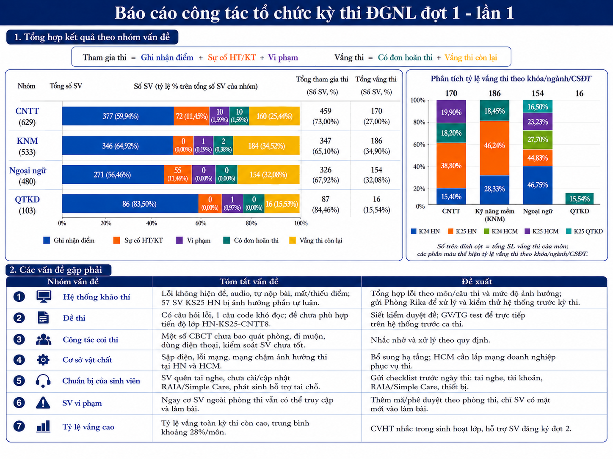

# Báo cáo ĐGNL Đợt 1 \- Tổ chức thi

# TỔNG QUAN KỲ THI

### Số liệu toàn kỳ thi

### Tổng hợp vấn đề

- Tổng quan vấn đề: 

- Chi tiết các vấn đề liên quan tới Hệ thống thi

### Phương án tổ chức thi lại/ thi bổ sung

- **Thời gian dự kiến: Ngày 22/08/2026**

- Số lượng cần tham gia Đợt thi bổ sung dự kiến như sau:

- Kế hoạch cho SV đăng ký như sau: 

# CÔNG NGHỆ THÔNG TIN

## I\. Số liệu tổng quan kỳ thi CNTT

Kỳ thi Đánh giá năng lực Công nghệ thông tin được tổng hợp từ 04 nhóm: **KS25 Hà Nội, K25 HCM và K24HN, K24 HCM**\.

### Đánh giá tổng quan

- Tổng quy mô: **629** **sinh viên**\.

- Tham gia: **459 sinh viên**, đạt **73,00%**\.

- Vắng: **170 sinh viên**, chiếm **28,6%**\.

- Ghi nhận **10 sinh viên vi phạm**, tương đương khoảng **2,2% số SV tham gia thi**\.

- Ghi nhận ít nhất **73 lượt sinh viên gặp vấn đề liên quan đến hệ thống/kỹ thuật**, tương đương khoảng **16,3% số SV tham gia**\.

- Các vấn đề nghiêm trọng nhất tập trung tại **KS25 Hà Nội \- đặc biệt với ca thi đầu tiên 07:00 \- 9:00 ngày 10/08/2026**, liên quan đến hệ thống nộp bài, chấm phần tự luận, chất lượng đề thi và việc kiểm soát điều kiện tổ chức thi\.

### Vấn đề chính trong kỳ thi

Qua tổng hợp, kỳ thi phát sinh **04 nhóm vấn đề chính**:

1. **Hệ thống khảo thí chưa ổn định**, ảnh hưởng trực tiếp đến bài thi và kết quả của sinh viên\.

2. **Đề thi và quy trình kiểm duyệt đề chưa đảm bảo**, có lỗi nội dung, lỗi hiển thị và chưa đồng bộ hoàn toàn với tiến độ học\.

3. **Công tác coi thi và kiểm soát gian lận chưa chặt**, vẫn phát sinh sử dụng AI, xem bài cũ và máy thi còn tài liệu\.

    1. **Tỷ lệ vắng toàn kỳ thi cao: 170/629 SV – 27%**

**Vấn đề nghiêm trọng nhất là hệ thống khảo thí**, do đã phát sinh tình trạng mất bài, thiếu bài, tự động nộp bài, không có điểm tự luận và phải tổ chức thi lại\.

## II\. Vấn đề kỳ thi CNTT

# QUẢN TRỊ KINH DOANH

## I\. Số liệu kỳ thi Quản trị kinh doanh

## II\. Vấn đề kỳ thi Quản trị kinh doanh

Môn thi: Đánh giá năng lực QTKD \(K25HN\)

Ngày thi: 11/08/2026 

Danh sách SV vi phạm: 1 \(Hoàng Quốc Trung QTKD2 \- Vi phạm đồng phục \(mặc quần đùi áo phông\)\)

Số lượng SV vắng thi: 16/103

QTKD1: 05/34

QTKD2: 06/40

QTKD3: 05/29

**Danh sách CB vi phạm:**

**Cô Đặng Quỳnh Trang \(có mặt muộn: 06h46\)**

**Cô Nguyễn Ngọc Vân Khanh \(có mặt muộn: 06h48\)**

**Cô Hoàng Thị Hậu \(có mặt muộn: 06h51\)**

Vấn đề phát sinh: Không có

# NGOẠI NGỮ

## I\. Số liệu kỳ thi Ngoại ngữ

## II\. Vấn đề kỳ thi Ngoại ngữ

# KỸ NĂNG MỀM

## I\. Số liệu kỳ thi Kỹ năng mềm

## II\. Vấn đề kỳ thi Kỹ năng mềm

# Tổng hợp CBNV vi phạm trong Kỳ thi ĐGNL

