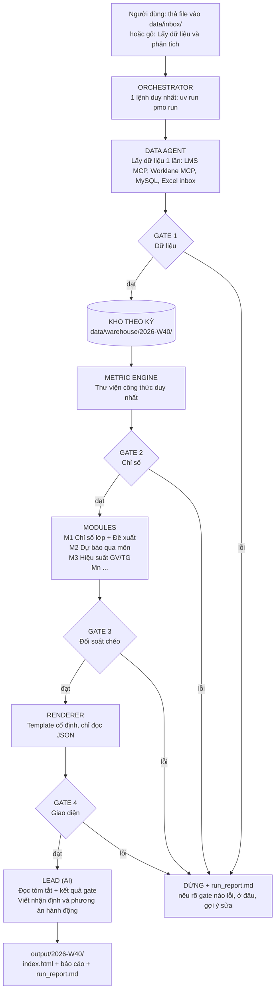

# Thiết kế: Hệ thống "Một lệnh — Tự động — Đúng ngay lần đầu"

> Ngày: 2026-10-04 · Trạng thái: **Đã duyệt (04/10/2026)** · Thay thế dần mô hình Agent 1-5 hiện tại

---

## 1. Bài toán

**Mong muốn của người dùng:** Đưa dữ liệu hoặc gõ một câu lệnh kiểu *"Lấy dữ liệu và phân tích tuần này"* → hệ thống tự lấy dữ liệu, tự tính, tự kiểm tra, tự xuất báo cáo đúng. Không phải sửa lại.

**Vì sao hiện tại phải làm lại nhiều lần:**

| Triệu chứng | Nguyên nhân gốc |
|---|---|
| Chỉ số sai, lệch giữa các báo cáo | Mỗi agent tự lấy dữ liệu, tự tính bằng công thức riêng (Python ≠ JS ≠ API) |
| Lỗi cũ tái phạm (8 lần lỗi BTVN/CC) | Bài học chỉ được **ghi bằng chữ** trong `super_memory.md`; AI có thể đọc sót hoặc bỏ qua. Không có gì **chặn** lỗi lại |
| UI/UX bị vỡ, mỗi lần một kiểu | AI sinh lại / sửa tay HTML mỗi lần chạy; số liệu bị gõ cứng trong HTML |
| Không biết kết quả đúng hay sai | "Kiểm tra" hiện chỉ là: file có tồn tại và > 0 byte |
| Tốn token, thời gian | AI đọc dữ liệu thô và tự tính thay vì script |

### Trả lời câu hỏi: *"Công đoạn verify theo ngữ cảnh trước đó nằm ở đâu?"*

**Hiện tại: không nằm ở đâu cả.** Ngữ cảnh trước đó chỉ tồn tại dưới dạng văn bản (`super_memory.md`, `AGENTS.md`), và việc tuân thủ phụ thuộc vào trí nhớ của AI trong từng phiên. `compare_report_vs_live.py` là bước kiểm tra đúng hướng nhưng nằm trong `scratch/` và phải chạy tay.

**Nguyên tắc mới:** *Mỗi bài học phải trở thành một phép kiểm tra chạy được (test/gate), không chỉ là một dòng ghi nhớ.* Pipeline **từ chối xuất báo cáo** nếu bất kỳ phép kiểm tra nào thất bại.

---

## 2. Kiến trúc



### 2.1 Phân công rõ ràng: Script tính — AI nhận định

| Việc | Ai làm | Lý do |
|---|---|---|
| Lấy dữ liệu, tính chỉ số, dự báo, chấm điểm | **Script (Python)**, tất định | Lặp lại được, không tốn token, không "sáng tạo" sai công thức |
| Kiểm tra (gates) | **Script + test** | Không phụ thuộc trí nhớ AI |
| Dựng HTML | **Template cố định** | UI không đổi giữa các lần chạy |
| Đọc kết quả, giải thích, đề xuất hành động | **AI (Lead)** | Đây là phần AI làm tốt; chỉ đọc file tóm tắt vài KB |

> AI **không được** sửa số liệu trong HTML, **không được** tự tính lại chỉ số. Nếu số sai → sửa ở Metric Engine + thêm test.

### 2.2 Data Agent & Kho dữ liệu theo kỳ

```
data/
├── inbox/                     # Người dùng thả file Excel/SQL mới vào đây
└── warehouse/
    └── 2026-W40/
        ├── manifest.json      # thời điểm lấy, nguồn, số dòng, kết quả Gate 1
        ├── registry.json      # Lớp ↔ Môn ↔ GV/TG ↔ SV ↔ courseClassId (nguồn sự thật duy nhất)
        ├── raw/               # bản gốc API/Excel để truy vết
        ├── student_metrics.json   # CC/BT/EL đã tính chuẩn FE
        ├── grades.json            # điểm, kết quả môn trước
        └── staff_activity.json    # báo cáo ngày, task, dự án Worklane
```

- **Lấy một lần mỗi kỳ.** Chạy lại trong cùng kỳ sẽ dùng cache, trừ khi gọi `--refresh`.
- `registry.json` thay thế danh mục lớp/GV đang nằm rải rác trong `super_memory.md` và từng script.

### 2.3 Modules (mỗi mục tiêu = 1 module)

| Module | Đầu vào (chỉ từ kho) | Đầu ra |
|---|---|---|
| **M1 Chỉ số lớp** | `student_metrics`, `registry` | Đánh giá từng lớp + đề xuất cải thiện theo vấn đề (CC/BT/EL) |
| **M2 Dự báo qua môn** | Kết quả M1 + `grades` | Tỷ lệ qua môn dự báo theo lớp và sinh viên, Care List |
| **M3 Hiệu suất GV/TG** | `staff_activity`, `registry`, kết quả M1 | Vi phạm báo cáo Worklane, trễ dự án/task, vi phạm quy định đào tạo → điểm hiệu suất |
| **M4 Chẩn đoán lớp** (đã có, 09/10) | `student_metrics`, `raw/lms` (danh sách SV) | Gộp mọi môn của lớp: cấp lớp/cấp môn, SV vi phạm đa môn, vắng toàn bộ, mã tạm, lệch danh sách giữa các môn |

Mỗi module xuất 2 file: `result.json` (đầy đủ, cho renderer) và `summary.json` (≤ 5KB, cho AI đọc).
Nhận định của AI hiển thị trên báo cáo lưu riêng `nhan_dinh.json` trong thư mục module, gắn `dataAt` của manifest; renderer cảnh báo nếu `dataAt` lệch với dữ liệu hiện tại.
**Thêm báo cáo mới** = tạo thư mục module mới theo cùng giao diện; không đụng tới dữ liệu hay module khác.

### 2.4 Bốn cổng kiểm định — nơi "ngữ cảnh trước đó" được thực thi

| Gate | Kiểm tra gì | Ví dụ biến bài học cũ thành luật |
|---|---|---|
| **G1 Dữ liệu** | Schema, độ mới, sĩ số > 0, mọi lớp trong registry đều có dữ liệu, số dòng không biến động bất thường so với kỳ trước | Bài học #3 *courseClassId cũ* → lớp có `totalStudents = 0` là **lỗi chặn** |
| **G2 Chỉ số** | (a) Bất biến: tỷ lệ trong [0,100], buổi ≤ 3 thì không cấm thi... (b) **Bộ giá trị chuẩn (golden set)** đối chiếu với số liệu thật trên LMS Frontend | Bài học #1 *BTVN chia tổng cả môn* → test: SV nộp đủ bài đã đến hạn ⇒ vi phạm BT = 0% |
| **G3 Đối soát chéo** | Cùng một lớp: sĩ số, số SV vi phạm khớp nhau giữa M1, M2, M3 và mọi view | Sửa 1 view quên 2 view → lệch số là lỗi chặn |
| **G4 Giao diện** | Số liệu trong HTML đã render == JSON (tổng quát hóa `compare_report_vs_live.py`); kiểm tra trình duyệt: không lỗi console, không trắng trang, đủ các tab | Bài học #2 *hardcode HTML* |

**Vòng học liên tục:** Mỗi khi người dùng phát hiện và sửa một lỗi → bắt buộc thêm 1 test vào `tests/regression/` + 1 mục `docs/DECISIONS.md` nếu là quyết định nghiệp vụ. Lỗi đã sửa thì **không thể tái phạm** mà không bị gate chặn.

### 2.5 Một lệnh duy nhất

```
uv run pmo run                 # kỳ hiện tại, dùng cache nếu có
uv run pmo run --refresh       # lấy dữ liệu mới
uv run pmo run --only m1,m2    # chạy một phần
uv run pmo verify              # chỉ chạy gates trên kỳ gần nhất
```

Một **skill** `.agents/skills/run-analytics/SKILL.md` gắn câu lệnh tự nhiên ("lấy dữ liệu và phân tích", "thống kê tuần này"...) với quy trình: chạy lệnh → đọc `run_report.md` → nếu đạt hết gate thì viết nhận định; nếu lỗi thì báo đúng gate lỗi, **không** tự ý sửa số cho khớp.

### 2.6 Cấu trúc đầu ra

```
output/
├── 2026-W40/
│   ├── index.html            # cổng duy nhất, link tới mọi báo cáo kỳ này
│   ├── run_report.md         # kết quả 4 gate + thời gian + nguồn dữ liệu
│   ├── lop/                  # M1
│   ├── du_bao/               # M2
│   ├── nhan_su/              # M3
│   └── tong_hop.md           # nhận định & phương án của Lead
├── latest -> 2026-W40        # luôn trỏ tới kỳ mới nhất
└── _archive/                 # báo cáo kiểu cũ
```

---

## 3. Quyết định kỹ thuật

| Quyết định | Lựa chọn | Lý do |
|---|---|---|
| Ngôn ngữ | **Python** cho toàn bộ (chuyển `lms_fe_formulas.js` sang Python, có test đối chiếu với bản JS) | Phần lớn code hiện có là Python; một ngôn ngữ thì chỉ có một nguồn công thức |
| Gọi LMS/Worklane MCP | Python HTTP client (JSON-RPC) | Bỏ phụ thuộc Node trong pipeline |
| Template | Jinja2 + dữ liệu JSON nhúng, JS render phía client | Tách UI khỏi dữ liệu |
| Test | pytest | Có sẵn trong hệ sinh thái `uv` |
| Kiểm tra trình duyệt | `browser_subagent` (VisualQA) ở bước cuối | Đã có skill `automated-visual-testing` |

---

## 4. Lộ trình chuyển đổi (chạy song song, không gián đoạn báo cáo)

| Giai đoạn | Nội dung | Kết quả có thể kiểm chứng |
|---|---|---|
| **P0 – Chốt chuẩn** (1-2 ngày) | Thu **golden set**: chọn 3-5 lớp, lấy số liệu đúng trên LMS FE do người dùng xác nhận. Chuyển 3 bài học ở `super_memory.md` mục 11 thành test | `tests/golden/` + `tests/regression/` có test, hiện **fail** |
| **P1 – Data Agent + G1** (3 ngày) | Kho theo kỳ, `registry.json`, manifest, cache | 1 lệnh lấy đủ dữ liệu kỳ W40; G1 đạt |
| **P2 – Metric Engine + G2** (2-3 ngày) | Chuyển công thức FE sang Python | Golden set và regression test đạt |
| **P3 – Modules M1/M2/M3 + G3** (4-5 ngày) | Viết lại logic từ Agent 1-4 dựa trên kho | Đối soát chéo đạt; số liệu khớp golden |
| **P4 – Renderer + G4** (3-4 ngày) | Template cố định, cấu trúc `output/<kỳ>/` | So khớp HTML với JSON đạt; VisualQA đạt |
| **P5 – Orchestrator + Skill + Lead** (2 ngày) | `pmo run`, `run_report.md`, skill câu lệnh tự nhiên | Gõ 1 câu → nhận báo cáo, không sửa tay |
| **P6 – Cắt chuyển** (2 tuần chạy song song) | So sánh kết quả cũ/mới 2 kỳ; sau đó đưa `agents/`, `scripts/` cũ vào `legacy/` (Đợt B); cập nhật `AGENTS.md`, `docs/STATUS.md` | Hệ thống cũ ngừng chạy |

> [!IMPORTANT]
> P0 là then chốt: không có golden set do người dùng xác nhận thì không có cách tự động biết "đúng". Đây là phần duy nhất cần người dùng tham gia trực tiếp.

---

## 5. Ngoài phạm vi (YAGNI)
- Lead dạng planner tự do (hỏi gì đáp nấy) — xem xét sau P6.
- Cơ sở dữ liệu mới (DuckDB/Postgres) — JSON theo kỳ là đủ ở quy mô hiện tại (khoảng 25 lớp, khoảng 40 nhân sự).
- Thay đổi trọng số KPI — giữ nguyên, chỉ thay cách tính cho đúng.
