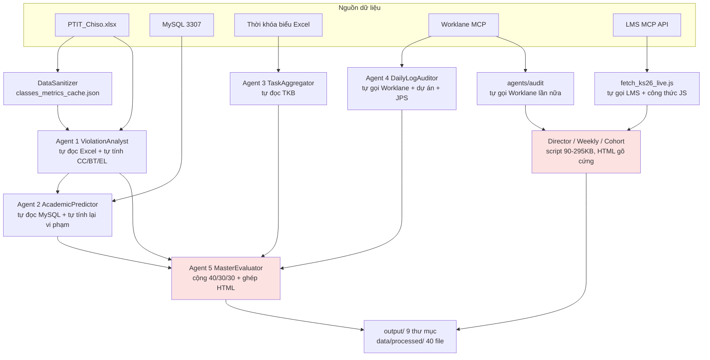
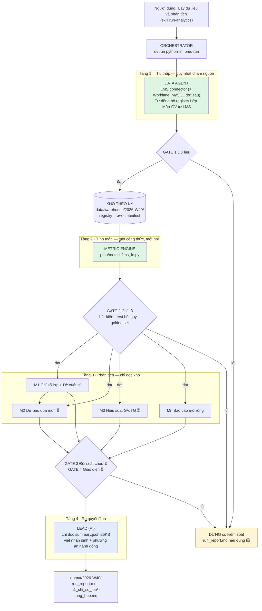

# So sánh Mô hình Agent Cũ và Mới

> Cập nhật: 04/10/2026 · Thiết kế: [[architecture/data-hub|Data Hub + Verification Gates]]

---

## 1. Sơ đồ mô hình CŨ (Agent 1-5, chia theo nguồn dữ liệu)

**Đặc điểm:** mỗi agent tự lấy dữ liệu, tự tính, tự in. Kiểm tra duy nhất là "file có tồn tại và > 0 byte".

---

## 2. Sơ đồ mô hình MỚI (PMO Data Hub, chia theo tầng trách nhiệm)

✅ đã chạy được · ⏳ đợt tiếp theo

---

## 3. So sánh theo tiêu chí

| Tiêu chí | Mô hình cũ | Mô hình mới |
|---|---|---|
| **Cách chia agent** | Theo nguồn/file đầu ra (Agent 1 = Excel, Agent 4 = Worklane...) | Theo tầng trách nhiệm: Thu thập → Tính → Phân tích → Quyết định |
| **Lấy dữ liệu** | Mỗi agent tự lấy; Worklane bị gọi ở 3 nơi | **1 Data Agent**, 1 lần/kỳ, có cache (chạy lại trong kỳ: 0 lần gọi API) |
| **Công thức CC/BT/EL** | 3 bản: Python Agent 1, Python Agent 2, JS `lms_fe_formulas.js` | **1 bản** `pmo/metrics/lms_fe.py`, khóa bằng test đối chiếu 303 bộ dữ liệu với bản JS |
| **Danh mục Lớp ↔ Môn ↔ GV** | Rải trong `super_memory.md`, file scratch, từng script | `registry.json` **tự đồng bộ từ LMS** mỗi kỳ |
| **Vai trò Lead** | Cộng 40/30/30 và ghép HTML | Gác cổng (từ chối dữ liệu sai), đối soát, viết nhận định và phương án hành động |
| **Kiểm tra đúng/sai** | File tồn tại và > 0 byte | 4 cổng kiểm định; FAIL thì dừng, không xuất báo cáo sai |
| **Ngữ cảnh/bài học cũ** | Ghi chữ trong `super_memory.md`, phụ thuộc trí nhớ AI | **Bài học = test chạy được** (`tests/regression/`, `tests/golden/`) |
| **Vai trò của AI** | Đọc dữ liệu thô, tự tính, sửa HTML | Chỉ đọc tóm tắt ≤5KB và nhận định; không chạm số liệu |
| **Thêm báo cáo mới** | Viết agent/script mới, tự lấy dữ liệu lại | Thêm 1 module đọc kho, đăng ký vào `REGISTRY` |
| **Đầu ra** | 9 thư mục + 40 file trung gian lẫn lộn | `output/<kỳ>/` + `run_report.md` |
| **Bảo mật** | Token LMS gõ cứng trong `fetch_ks26_live.js` | Token trong `.env`, không commit |
| **Truy vết** | Không lưu bản gốc | Lưu nguyên phản hồi API trong `raw/` của từng kỳ |

---

## 4. Bằng chứng thực tế từ lần chạy đầu tiên (04/10/2026, kỳ 2026-W40)

Ngay lần chạy đầu, **Gate 1 đã chặn một lỗi mà mô hình cũ đang hiển thị sai mà không ai biết**:

| Lớp / Môn | Mã trong cấu hình cũ | Mã hiện hành trên LMS | Mô hình cũ hiển thị |
|---|---|---|---|
| HN-K26-QTKD2 / SSK103 | `6ab4d8222f8b9a21479d3175` | `6ab5e4412fbc7e0fab150866` | Sĩ số 0, "Chưa vào môn" |
| HN-K26-QTKD2 / SSK102 | `6ab4d8142f8b9a21479d2eac` | `6ab5e40b2fbc7e0fab150584` | Sĩ số 0, "Chưa vào môn" |
| HN-K26-QTKD1 / SSK102 | `6aafaa13a7defdd54c03c945` | `6ab5e3dd2fbc7e0fab150308` | Sĩ số 0, "Chưa vào môn" |

Đây đúng là **Bài học #3 (courseClassId cũ)** đã ghi trong `super_memory.md` nhưng vẫn tái phạm. Ở mô hình mới:
1. Gate 1 phát hiện và **dừng** thay vì xuất báo cáo sai.
2. Data Agent được nâng cấp để **tự lấy mã hiện hành từ LMS** mỗi kỳ.
3. Một test hồi quy được thêm để lỗi này không thể quay lại.

**Kết quả sau khi sửa:** 28/28 lớp-môn có dữ liệu (mô hình cũ: 25/28). M1 xếp hạng: 6 Báo động · 13 Đôn đốc · 2 Nhắc EL · 7 Chuẩn mực; 29 đề xuất hành động có người phụ trách.

| Lần chạy | Gọi API | Thời gian | AI phải đọc |
|---|---|---|---|
| Lần đầu trong kỳ (`--refresh`) | 38 (10 registry + 28 thống kê) | ~19s (gồm cả bộ test) | `summary.json` 2.4KB |
| Chạy lại trong kỳ | **0** | ~3s | `summary.json` 2.4KB |

---

## 5. Đánh giá

**Điểm mạnh của mô hình mới**
- Số liệu nhất quán vì chỉ có một nguồn và một công thức.
- Lỗi bị chặn tự động trước khi tới tay người đọc.
- Nhanh và rẻ: lần chạy lại trong kỳ không gọi API; AI chỉ đọc vài KB.
- Mở rộng báo cáo mới mà không lấy lại dữ liệu.

**Hạn chế / rủi ro còn lại**
- Chưa có **golden set** do người dùng xác nhận → Gate 2 mới cảnh báo, chưa khẳng định khớp 100% LMS Frontend.
- CC vẫn lệch tối đa 1-2 SV do API không tách vắng KP/CP/Muộn (giới hạn của API, không phải của mô hình).
- M2, M3, Renderer HTML, Gate 3/4 chưa xong → Agent 1-5 cũ vẫn chạy song song trong giai đoạn chuyển đổi.

**Lộ trình còn lại:** P0 golden set → M3 (Worklane connector) → M2 → Renderer + G3/G4 → cắt chuyển và lưu trữ agent cũ.

---
Trở về: [[README|Mục lục tài liệu]]
